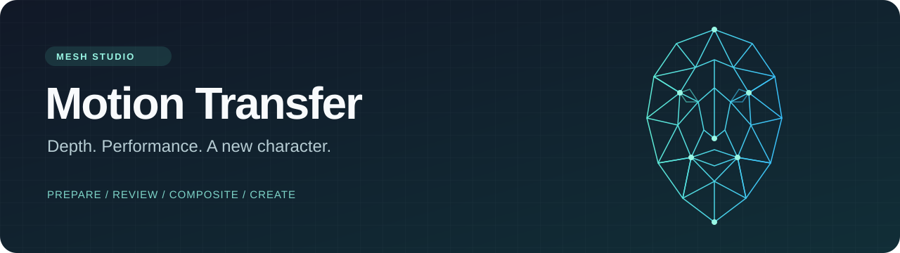
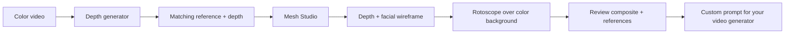

<p align="center">
  
</p>

<p align="center">
  <strong>Turn a performance into a depth-and-face motion reference.</strong><br>
  Generate depth, add facial wireframes, composite your character region, and prepare a character-replacement prompt.
</p>

<p align="center">
  <a href="#quick-start">Quick start</a> ·
  <a href="docs/COLAB.md">Depth generator</a> ·
  <a href="docs/WEB_UI.md">Mesh Studio guide</a> ·
  <a href="docs/WORKFLOW.md">Full workflow</a> ·
  <a href="#guides">All guides</a>
</p>

<p align="center">
  
  
  
  <a href="https://colab.research.google.com/github/hashiro-cloud/motion-transfer/blob/main/notebooks/Depth_Anything_V2_Video_GUI.ipynb"></a>
</p>

## What this project does

Motion Transfer prepares control media for a character-replacement video workflow. The local engine detects **478 facial landmarks on the color video** and draws a wireframe on the corresponding depth frames. You can review the result in a browser, save the clean MP4, and change its appearance without tracking again.

| Component | What you get | Where it runs |
| --- | --- | --- |
| **Depth generator** | A matching `source_reference.mp4` + `depth.mp4` pair | Optional Google Colab notebook; NVIDIA GPU runtime |
| **Mesh Studio** | Browser controls, previews, downloads, and recent runs | Your Windows PC; CPU face tracking |
| **Command-line tools** | Reviewed alignment, reusable landmarks, and rendering options | Your Windows PC |
| **Agent workflow** | Media review, editor handoff, reference planning, and a custom video prompt | Your coding agent, using the included skill |

The mesh export is a **silent depth video with facial lines**. You rotoscope the replacement region in your editor and use a video generator of your choice afterward. This project does not automatically replace a character, create a transparency mask, or run a hosted generation.

## The workflow at a glance



Already have matching color and depth clips? Start at **Mesh Studio**.

## Quick start

### 1. Download the project

Use **Code → Download ZIP** on GitHub and extract the folder, or clone it:

```powershell
git clone https://github.com/hashiro-cloud/motion-transfer.git
cd motion-transfer
```

Keep the complete folder, including the hidden `.agent/` directory. No personal footage, previous results, Python environment, or downloaded model weights are included.

### 2. Prepare your two videos

You need a **color reference** and the **depth video generated from that same reference**, with matching crop, orientation, timing, and cuts.

If you need depth, [open the included notebook in Colab](https://colab.research.google.com/github/hashiro-cloud/motion-transfer/blob/main/notebooks/Depth_Anything_V2_Video_GUI.ipynb), select a GPU runtime, and run its cells. Download **both** `source_reference.mp4` and `depth.mp4`. Use that exported reference in Mesh Studio and your editor, because the notebook may normalize the uploaded video's timing and orientation. See the [Colab guide](docs/COLAB.md).

### 3. Open Mesh Studio

On **Windows x64**, double-click **[`Start-Mesh-Studio.cmd`](Start-Mesh-Studio.cmd)**.

The launcher checks the environment, installs missing tools locally, and opens the app at [127.0.0.1:8765](http://127.0.0.1:8765). First setup needs internet access. Keep the launcher window open while using the app; press **Ctrl+C** there to stop it.

Prefer PowerShell?

```powershell
.\Start-Mesh-Studio.ps1
```

### 4. Create and save the wireframe

1. Select or drag in the color reference and matching depth video.
2. Click **Create wireframe** and wait for processing.
3. Review **Comparison** for facial placement, timing, cuts, and missed faces.
4. Select **Final video**, then **Save video** to save the clean export.

The browser route assumes matching framing and the same start moment. Its checks do not prove visual alignment. Use the [command-line workflow](docs/WORKFLOW.md#command-line-processing) for measured crop, mirror, or time-offset mappings.

### 5. Composite and prepare your generation

Put the color reference on your editor's lower track and the aligned depth-plus-wireframe export above it. **Keep the character region visible in the upper layer and make the rest of that layer transparent.** The lower track supplies the photographic background.

Review the matte around hair, hands, clothing, props, and cuts, then export a clean composite. That composite becomes the motion reference for your chosen video generator. See [the editor and prompting guide](docs/WORKFLOW.md#4-composite-in-your-editor).

## Requirements and setup

| | Local mesh engine | Optional depth notebook |
| --- | --- | --- |
| Platform | Windows x64; PowerShell 5.1+ or 7 | Google Colab |
| Compute | CPU; no GPU required | NVIDIA GPU runtime required |
| Internet | Initial setup and repairs; healthy installs process offline | Setup, model downloads, and hosted session |
| Account / API key | No cloud account or API key for local processing | Colab account; no model API key |
| Disk space | Runtime, model, packages, uploads, and rendered outputs | Temporary runtime storage for videos and depth predictions |

Setup provisions project-local Python **3.12.13**, locked packages, verified model assets, and missing uv/FFmpeg tools. Healthy system tools may be reused. No administrator access or global PATH change is needed. The automatic installer does not support macOS, Linux, or Windows ARM.

To check or repair setup before a session:

```powershell
.\Ensure-Environment.ps1
```

For installation errors, a blocked PowerShell script, another port, or download issues, see [Troubleshooting](docs/WEB_UI.md#troubleshooting).

## Command-line example

Always specify your own input paths and a separate output directory for each pair. Paths with spaces must stay quoted.

```powershell
.\Mesh-Video.ps1 -Action inspect -Original 'inputs\source_reference.mp4' -Depth 'inputs\depth.mp4' -OutputDirectory 'outputs\my-shot'
```

Inspect `outputs/my-shot/alignment_contact_sheet.jpg`. After confirming the spatial and temporal match, edit `alignment.json`: set `visually_verified` to `true` and describe the evidence in `notes`. Preserve its input hashes. Then process the same pair:

```powershell
.\Mesh-Video.ps1 -Action run -Original 'inputs\source_reference.mp4' -Depth 'inputs\depth.mp4' -OutputDirectory 'outputs\my-shot'
```

Change appearance later using the cached landmarks:

```powershell
.\Mesh-Video.ps1 -Action render -Original 'inputs\source_reference.mp4' -Depth 'inputs\depth.mp4' -OutputDirectory 'outputs\my-shot' -Style contours -Color FFFFFF
```

The [full workflow guide](docs/WORKFLOW.md) covers transforms, time offsets, track selection, files, and review.

## Use with a coding agent

The self-contained skill is [`local-motion-transfer`](.agent/skills/local-motion-transfer/SKILL.md), routed through [`AGENTS.md`](AGENTS.md). Open the project in your agent and give it your actual input paths, for example:

> Read AGENTS.md and follow the local-motion-transfer skill. My matching color and depth clips are in inputs/. Prepare and review the wireframe, then guide me through compositing and a character-replacement prompt.

The skill includes setup, video analysis, editor handoff, composite review, reference roles, prompt writing, and result review. It uses the shipped scripts and does not require the author's other skills, previous chats, or sample footage. An agent needs suitable media inspection tools to perform visual review; a successful render report alone does not establish visual quality.

## Files, privacy, and limitations

- **Local media stays local in Mesh Studio.** The server binds to loopback. First-time setup downloads dependencies; optional Colab processing uploads your video to that hosted runtime. An agent or later generator follows its own data handling.
- **Runs are retained.** Browser uploads and results stay in `outputs/web/<run-id>/` until you remove them. Use a fresh folder for each CLI pair; rerunning in an existing folder can replace generated files.
- **Personal files are excluded from Git.** Inputs, outputs, downloaded assets, runtime folders, video/audio files, secrets, and local development notes are ignored. Do not force-add private media when sharing a fork.
- **Detection has limits.** Small, blurred, turned, or obscured faces can lose the mesh. Missing detections stay mesh-free; hidden expression is not reconstructed. Track IDs describe geometric continuity, not person recognition.
- **Review downstream results.** A face mesh is not a rotoscope mask. The export has no alpha or audio, and does not guarantee frame-exact character replacement.

## Guides

| Guide | Use it for |
| --- | --- |
| [Colab depth generator](docs/COLAB.md) | GPU setup, depth settings, downloads, and the matching reference pair |
| [Mesh Studio](docs/WEB_UI.md) | Browser launch, controls, recent runs, saving, and troubleshooting |
| [Complete workflow](docs/WORKFLOW.md) | CLI processing, alignment, outputs, editor compositing, and prompting |
| [Development and testing](docs/DEVELOPMENT.md) | Source layout, environment checks, tests, and notebook maintenance |
| [Agent skill](.agent/skills/local-motion-transfer/SKILL.md) | Stage-by-stage instructions for a coding agent |

## Credits and third-party components

Face tracking uses [MediaPipe](https://github.com/google-ai-edge/mediapipe); video processing uses [PyAV](https://github.com/PyAV-Org/PyAV), [OpenCV](https://github.com/opencv/opencv), and [FFmpeg](https://ffmpeg.org/). Setup uses [uv](https://github.com/astral-sh/uv). The optional notebook uses the official [Depth Anything V2](https://github.com/DepthAnything/Depth-Anything-V2) implementation and [Gradio](https://github.com/gradio-app/gradio).

Third-party tools and model weights retain their own licenses. In particular, Depth Anything V2 **Small** is Apache-2.0 and **Base/Large** are CC-BY-NC-4.0; review the [upstream license details](https://github.com/DepthAnything/Depth-Anything-V2#license) before choosing a model for your use case. Downloaded third-party binaries and weights are not bundled in this repository.

Found a problem? [Open an issue](https://github.com/hashiro-cloud/motion-transfer/issues) with the command or UI action, error text, and relevant software versions. Remove personal paths and media from logs before posting.
